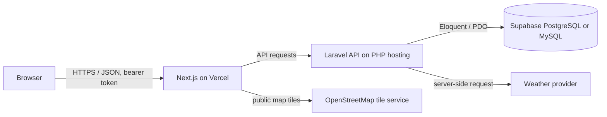

# CityPulse — System Integration Midterm Remediation

A learning project scaffold for an authenticated dashboard that brings together a Next.js frontend, a Laravel JSON API, persistent database storage, and map/weather integrations.

> This repository is a starter scaffold, not a finished or deployed application. Do not claim a feature works until you configure and verify it. PHP and Composer were unavailable when the scaffold was created, so the Laravel backend still needs to be installed and run in a PHP environment.

## Architecture

## Features planned

- Responsive login, registration, and protected dashboard UI
- Laravel API with server-side validation and hashed passwords
- Persistent database-backed users and bearer-token authentication
- Password recovery and TOTP-based MFA (implementation remains to be completed)
- Map and weather integrations with loading/error states
- Vercel frontend + separately hosted Laravel API

## Technology

Next.js / React / TypeScript, Laravel / PHP, PostgreSQL or MySQL, Git/GitHub, Vercel, PHP-compatible backend hosting.

## Local setup

### Frontend

1. Install a current Node.js LTS release.
2. `cd frontend && npm install`
3. Copy `.env.example` to `frontend/.env.local`.
4. Set `NEXT_PUBLIC_API_URL` to the Laravel API URL.
5. `npm run dev`, then open http://localhost:3000.

### Backend

1. Install PHP (including `pdo_pgsql` for PostgreSQL or `pdo_mysql` for MySQL), Composer, and a supported Laravel release.
2. Create a Laravel API project in `backend/` and install Laravel Sanctum. The `routes/api.php` and controller/model files in this scaffold are integration references and need to be reconciled with the generated Laravel version.
3. Copy `backend/.env.example` to `backend/.env`, configure database and mail settings, then run `php artisan key:generate`, `php artisan migrate`, and `php artisan serve`.
4. Configure Sanctum/token authentication and CORS before connecting the frontend.

## Environment variables

Frontend (`frontend/.env.local`, safe for browser exposure only):

| Name | Purpose | Example |
|---|---|---|
| `NEXT_PUBLIC_API_URL` | Laravel API base URL | `http://localhost:8000/api` |
| `NEXT_PUBLIC_MAP_TILE_URL` | Map tile URL template | OpenStreetMap URL |

Backend (`backend/.env`, private): use Laravel's `APP_KEY`, `APP_URL`, database variables (`DB_CONNECTION`, `DB_HOST`, `DB_PORT`, `DB_DATABASE`, `DB_USERNAME`, `DB_PASSWORD`), mail provider settings, and private weather provider key. Never place database credentials, `APP_KEY`, mail credentials, or privileged keys in a `NEXT_PUBLIC_` variable.

## API contract (planned)

| Method | Path | Purpose | Auth |
|---|---|---|---|
| POST | `/api/register` | Create account | No |
| POST | `/api/login` | Sign in / MFA challenge | No |
| GET | `/api/me` | Current user | Yes |
| POST | `/api/logout` | Revoke token | Yes |
| POST | `/api/forgot-password` | Request reset link (generic response) | No, throttled |
| POST | `/api/reset-password` | Reset with expiring token | No, throttled |
| POST | `/api/mfa/setup` | Begin TOTP enrollment | Yes |
| POST | `/api/mfa/verify` | Verify TOTP | Yes / challenge |
| GET | `/api/weather` | Fetch weather server-side | Yes |

Example registration request: `POST /api/register` with JSON `{ "name": "Alex Example", "email": "alex@example.com", "password": "use-a-long-password", "password_confirmation": "use-a-long-password" }`. Never use a real password in documentation or demos.

## Security work required before deployment

Use Laravel's password hashing and request validation; enforce authorization on every protected endpoint; store tokens securely and revoke them on logout; add throttles to login, reset, and MFA; use generic reset responses and short-lived one-use tokens; encrypt TOTP secrets at rest and limit verification attempts; restrict CORS to the deployed frontend origin; use HTTPS; keep private credentials in the backend host's secret store. These controls must be implemented and verified in the running backend.

## Deployment

- Push the repository to GitHub after reviewing it for secrets.
- Import `frontend/` into Vercel as the project root; set `NEXT_PUBLIC_API_URL` to the production Laravel URL and redeploy after changes.
- Deploy `backend/` to a PHP-capable host (not as a conventional PHP server on Vercel). Configure database, mail, weather key, `APP_KEY`, CORS, and HTTPS there.
- Add actual repository, Vercel, and API URLs here after deployment. None are configured yet.

## Status / known limitations

This initial scaffold contains the project structure and a UI starting point. Registration, API-backed login, reset, MFA, weather, map display, migrations, production deployment, and live URLs require implementation/configuration and must be tested before demonstration.
# SIA_Removal
