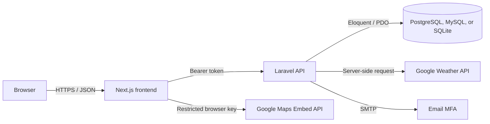

# CityPulse

CityPulse is a responsive city dashboard that brings account security, local weather, and maps into one focused experience. It pairs a Next.js frontend with a Laravel JSON API, a relational database, Google Maps Platform services, and email-based multi-factor authentication.

**Repository:** [github.com/BryanFLoreSs/SIA_Removal](https://github.com/BryanFLoreSs/SIA_Removal)<br>
**Author:** Bryan Flores<br>
**Project:** System Integration Midterm Remediation [Actually already passed]

## Highlights

- Create an account, sign in, reset a password, and revoke a session at logout.
- Enable email MFA and complete sign-in with a short-lived six-digit verification code.
- View current weather for Manila or a browser-selected location.
- Explore the selected location through an embedded Google Map.
- Receive clear success popups for completed account actions and inline feedback for form errors.

## Architecture



## Technology

| Layer | Technology |
|---|---|
| Frontend | Next.js, React, TypeScript |
| Backend | Laravel 12, PHP 8.2+ |
| Authentication | Laravel Sanctum and PHPMailer |
| Data | PostgreSQL, MySQL, or SQLite |
| Integrations | Google Maps Embed API and Google Maps Platform Weather API |

## Local setup

### Requirements

- Node.js 20+ and npm
- PHP 8.2+, Composer, and a supported PDO database driver
- A database server if you are not using SQLite
- A Google Maps Platform project for the map and weather integrations
- An SMTP account for email MFA in a full local sign-in test

### Backend

On Render, create a **Docker Web Service** with `backend` as the root directory. The included [`backend/Dockerfile`](backend/Dockerfile) installs PHP PostgreSQL support, serves Laravel from `public/`, and binds Apache to Render's `PORT` automatically.

```bash
cd backend
composer install
cp .env.example .env
php artisan key:generate
php artisan migrate
php artisan serve
```

Set the database values, frontend origin, weather key, and SMTP values in `backend/.env`. Never commit that file.

For Render, use [`backend/.env.render.example`](backend/.env.render.example) as the environment-variable checklist. Set `DB_URL` to the Supabase **Session pooler** connection URI with `sslmode=require`.

For Gmail SMTP, create an App Password and use it as `PHPMAILER_PASSWORD`; regular Gmail passwords will not work. The email address in `PHPMAILER_FROM_ADDRESS` should match the authorized SMTP sender.

### Frontend

```bash
cd frontend
npm install
cp .env.example .env.local
npm run dev
```

Set the following values in `frontend/.env.local`:

```env
NEXT_PUBLIC_API_URL=http://localhost:8000/api
NEXT_PUBLIC_GOOGLE_MAPS_API_KEY=replace-me
```

For Vercel, add the same two values from [`frontend/.env.production.example`](frontend/.env.production.example) in the project’s Environment Variables settings.

Open [http://localhost:3000](http://localhost:3000). The browser map key is public by design, so restrict it in Google Cloud to the application’s domains and the Maps Embed API.

## Email MFA flow

1. An authenticated user selects **Enable email MFA** in the dashboard.
2. At the next sign-in, CityPulse validates the password and sends a six-digit code through PHPMailer.
3. The code expires after five minutes and is limited to five verification attempts.
4. On success, the challenge is deleted and Laravel issues a Sanctum access token.

## API overview

| Method | Endpoint | Description | Authentication |
|---|---|---|---|
| `POST` | `/api/register` | Create an account | No |
| `POST` | `/api/login` | Sign in; sends an MFA code when enabled | No |
| `POST` | `/api/mfa/challenge` | Verify an email MFA code | No |
| `POST` | `/api/forgot-password` | Request a password-reset link | No |
| `POST` | `/api/reset-password` | Set a new password | No |
| `GET` | `/api/me` | Read the signed-in account | Yes |
| `POST` | `/api/mfa/enable` | Enable email MFA | Yes |
| `POST` | `/api/logout` | Revoke the active token | Yes |
| `GET` | `/api/weather` | Read weather for supplied coordinates | Yes |

Authentication and recovery routes are throttled. The weather endpoint accepts `city`, `latitude`, and `longitude` query parameters.

## Environment and security

- Keep `backend/.env` and `frontend/.env.local` private. The committed example files use placeholders only.
- Use HTTPS and set `FRONTEND_URL` and `CORS_ALLOWED_ORIGINS` to the exact deployed frontend origin.
- Restrict the Google Maps browser key by referrer and API; keep `WEATHER_API_KEY` on the backend.
- CityPulse hashes passwords and MFA codes, stores only encrypted or server-held sensitive data, and revokes the current Sanctum token at logout.
- The learning-project frontend uses local storage for its bearer token. A production system should consider secure, HttpOnly cookie sessions or a backend-for-frontend design.

## Deployment checklist

1. Configure the database, application key, frontend origin, Google keys, and SMTP credentials in the deployment platform.
2. Run `php artisan migrate --force` on the backend host.
3. Deploy the frontend with `NEXT_PUBLIC_API_URL` pointing to the HTTPS API URL.
4. Restrict CORS and Google Maps key referrers to the published domain.
5. Verify registration, email MFA, password recovery, location access, weather, map rendering, and logout in the deployed environment.

## Acknowledgments

- [Laravel](https://laravel.com/) provides the API framework and Sanctum authentication.
- [Next.js](https://nextjs.org/) and [React](https://react.dev/) power the frontend.
- [PHPMailer](https://github.com/PHPMailer/PHPMailer) delivers email MFA codes through SMTP.
- [Google Maps Platform](https://developers.google.com/maps) provides the Maps Embed and Weather APIs.

## License

This repository is provided for academic project use. Contact the author before reusing it beyond that context.
