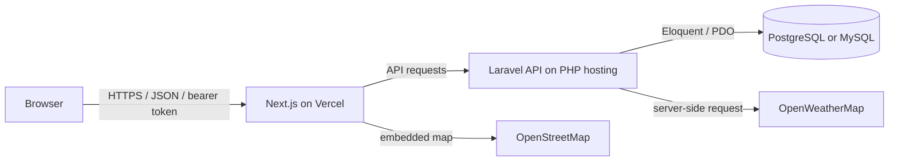

# CityPulse — System Integration Midterm Remediation

CityPulse is a city dashboard project built with a Next.js frontend and a Laravel JSON API. It is being developed as a system integration demonstration: the frontend calls protected Laravel endpoints, Laravel stores account records in PostgreSQL or MySQL, and the API fetches weather data from OpenWeatherMap. The dashboard map uses an embedded OpenStreetMap view centered on Manila.

## Architecture

## Implemented in this repository

- Responsive home, registration, login, recovery, reset, and dashboard pages.
- Frontend registration and login requests to Laravel; bearer token session storage, `/me` dashboard gate, and logout token revocation.
- Laravel API routes/controllers for registration, login, current user, logout, password recovery/reset, and weather.
- Password hashing and server validation through Laravel; generic password recovery response, throttled auth/reset routes, expiring single-use Laravel reset tokens, and server-only weather credentials.
- TOTP authenticator enrollment and login challenges, encrypted MFA secrets, short-lived challenges, and bounded verification attempts.
- Database migrations for users, reset tokens, and Sanctum personal access tokens.
- OpenStreetMap embedded map and a Laravel weather API integration.

**Still to complete:** production mail delivery, dependency installation, deployment, live production verification, and the final demo walkthrough. The backend dependencies cannot be installed in an offline environment; use Composer when Packagist is reachable.

## Local setup

### Backend

1. Install PHP 8.2+, Composer, and the PDO driver for your chosen database.
2. From `backend/`, run `composer install`.
3. Copy `.env.example` to `.env`, set database credentials and `FRONTEND_URL`, then run `php artisan key:generate`.
4. Run `php artisan migrate` and `php artisan serve`.
5. For local password recovery, use `MAIL_MAILER=log` and inspect `storage/logs/laravel.log` for the reset link. Configure a real mail service for deployed use.
6. Set `WEATHER_API_KEY` on the backend. The key is never sent to the browser.

### Frontend

1. From `frontend/`, run `npm install`.
2. Copy `.env.example` to `.env.local` and set `NEXT_PUBLIC_API_URL=http://localhost:8000/api`.
3. Run `npm run dev` and open http://localhost:3000.

## Environment variables

Frontend `.env.local` contains only `NEXT_PUBLIC_API_URL`, the public base URL of Laravel. Backend `.env` contains `APP_KEY`, `APP_URL`, `FRONTEND_URL`, `CORS_ALLOWED_ORIGINS`, database variables (`DB_CONNECTION`, `DB_HOST`, `DB_PORT`, `DB_DATABASE`, `DB_USERNAME`, `DB_PASSWORD`), mail settings, and private `WEATHER_API_KEY`. See the `.env.example` files for placeholders. Never commit live credentials.

## API contract

| Method | Path | Purpose | Auth |
|---|---|---|---|
| POST | `/api/register` | Create account and issue bearer token | No |
| POST | `/api/login` | Authenticate; request TOTP challenge when enabled | No |
| GET | `/api/me` | Return authenticated user | Yes |
| POST | `/api/logout` | Revoke current token | Yes |
| POST | `/api/forgot-password` | Send generic password-reset response | No, throttled |
| POST | `/api/reset-password` | Validate reset token and set new password | No, throttled |
| POST | `/api/mfa/setup` | Start authenticator enrollment | Yes, throttled |
| POST | `/api/mfa/enable` | Verify first authenticator code | Yes, throttled |
| POST | `/api/mfa/challenge` | Complete MFA login challenge | No, throttled |
| GET | `/api/weather?city=Manila` | Get current weather from configured provider | Yes |

Registration example: `POST /api/register` with JSON `{ "name": "Alex Example", "email": "alex@example.com", "password": "replace-with-a-long-password", "password_confirmation": "replace-with-a-long-password" }`.

## Deployment

- Deploy `frontend/` to Vercel and set `NEXT_PUBLIC_API_URL` to the HTTPS Laravel API URL.
- Deploy `backend/` to a PHP-compatible host, configure its environment variables and database, then run migrations.
- Set `FRONTEND_URL` and `CORS_ALLOWED_ORIGINS` to the deployed frontend origin, use HTTPS, and configure mail and weather provider credentials on the backend host.
- Confirm registration, sign-in, protected dashboard, weather, reset emails, and logout against production before the demonstration.

Vercel URL: _not deployed yet_  
Backend API URL: _not deployed yet_  
GitHub repository: _add the repository URL after pushing_

## Security and known limitations

Laravel hashes passwords, validates input server-side, uses Eloquent query binding, issues revocable Sanctum bearer tokens, throttles account endpoints, validates expiring reset tokens, and encrypts TOTP secrets at rest. The browser keeps the API token in local storage for this learning project; this is exposed to scripts running in the same origin, so a production-grade deployment should consider a backend-for-frontend with secure, HttpOnly cookies. CORS must be restricted to the deployed frontend origin. No production deployment or external provider configuration is included in the repository yet.
